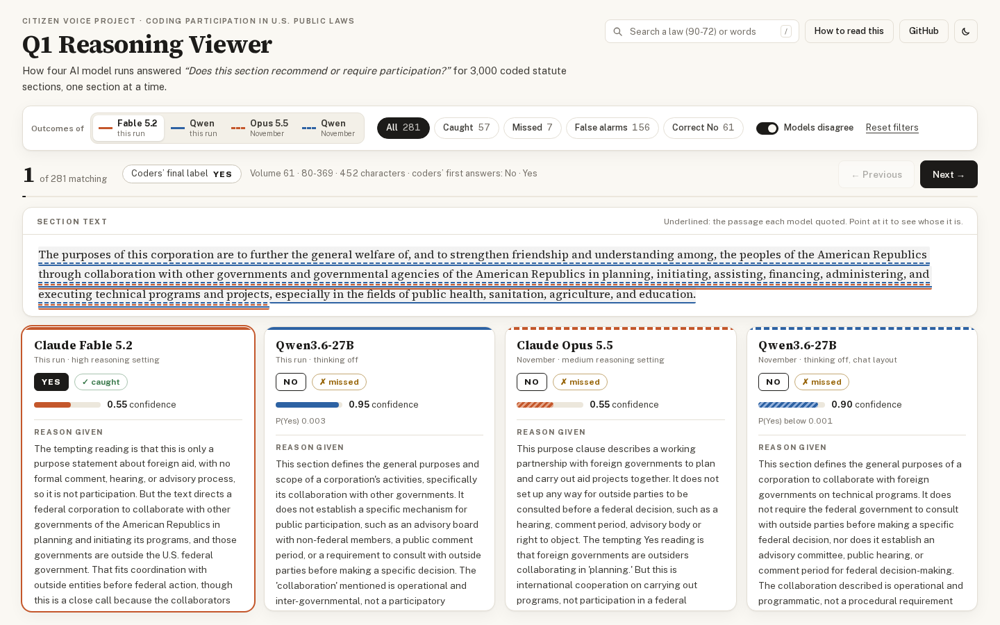

# Statute Participation Explorer

**Live site: https://statute-participation-explorer.vercel.app**

Step through 3,000 coded U.S. statute sections, one at a time, and see how four AI model runs answered
*“Does this section recommend or require participation?”*: each model’s answer, the confidence it stated, the reason it
gave and the passage it relied on, set against the human coders’ final label. A second tab, **Dashboard**, has the
numbers behind it.



The site, titled *Q1 Reasoning Viewer* after the study’s first question, is part of the Citizen Voice project, which codes
participation in U.S. public laws. The model runs and their analysis are in
[US-public-law-fewshot-agent](https://github.com/Asbetos/US-public-law-fewshot-agent).

## What it shows

All four runs labelled the same 3,000 sections with the same instructions, definition and 12 worked examples, and every
answer is checked against the same final label.

| Run | Study | Set-up |
|---|---|---|
| **Claude Fable 5.2** | this run | high reasoning setting, through the Batch API; the instructions as one block of text |
| **Qwen3.6-27B** | this run | thinking mode off, on the group’s own GPU; the instructions as one block of text |
| **Claude Opus 5.5** | November | medium reasoning setting; the instructions as one block of text |
| **Qwen3.6-27B** | November | thinking mode off; the instructions as a conversation |

The site has two tabs.

- **Sections** (`/`): one section per screen, described below.
- **Dashboard** (`/dashboard/`): this run’s two models, Claude Fable 5.2 and Qwen3.6-27B, against the coders’ final
  labels on all 3,000 sections. It explains each measure, shows where each model goes wrong and how sure it was, and
  lists every section where a model differs from the final label, with its reason. *Open as a full page* shows it on
  its own.

Each screen of the Sections tab holds one section:

- **The section text**, exactly as the models saw it, with the passage each model quoted underlined.
- **One card per model**: its answer; how that compares with the final label (*caught*, *missed*, *false alarm* or
  *correct No*); the confidence it stated, from 0 to 1; P(Yes) for Qwen; and the reason it gave.

**Colours** follow the model family, as on the project slides: orange is always Claude, blue is always Qwen. A solid line
marks this run; a dashed line and a paler fill mark the November runs.

**The final label** is Yes when every coder’s final answer is Yes; the few sections still split in the final sheet count as
Yes. The coders’ first answers, before they reconciled, are shown as labels only.

## Using the viewer

| To | Do this |
|---|---|
| see one model’s mistakes | pick the model under **Outcomes of**, then **Missed** or **False alarms** |
| see where the models split | turn on **Models disagree** |
| find a law or a phrase | type a law number (such as `90-72`) or any words into **Search** |
| move between sections | **Previous** and **Next**, or the **←** and **→** keys (**/** jumps to search) |
| share what is on screen | copy the address bar: it holds the section and the filters |

## Reading the results with care

- **A stated reason is the model’s own account** of its answer, written alongside it. It may not capture everything that
  produced the label. Fable and Opus can also think privately before answering, and did on most sections; that
  thinking was not saved.
- **Stated confidence is the model’s own claim**, not a measured probability.
- **P(Yes)** is the probability Qwen’s own output gave the word “Yes” where it wrote its label. It is almost always very
  close to 0 or 1.
- **The final label is the coders’ reconciled judgement**, not an absolute truth; some disagreements may be coding errors.

## The data

`public/data/` holds everything the site reads. It is generated by the study repo, not edited by hand.

| File | What it holds | When the site loads it |
|---|---|---|
| `index.json` | every section’s final label and each run’s label and confidence | on opening |
| `sections/<id>.json` | one section’s text and each run’s full answer | when that section is shown (the next ones are fetched ahead) |
| `search.json` | every section’s text and reasons, lower-cased | the first time someone searches for words |

`public/embed/dashboard.html` is the Dashboard tab’s page: the study’s dashboard, one self-contained file, built with
this site’s typeface (`public/fonts/`) and colours. Inside the tab it drops its own title and theme button and follows
the site’s theme switch.

To regenerate both, run this in the study repo:

```bash
./eval/run_q1_block.sh site     # public/data and public/embed/dashboard.html (SITE= points at this checkout)
```

## Running it locally

```bash
npm install
npm run dev        # http://localhost:3000
npm run build      # the static site, in out/
npm run preview    # serve out/ locally
```

It needs Node 20.9 or later (see `.nvmrc`). The site is fully static (Next.js with `output: "export"`, one folder per
page); Vercel builds it from `main` and serves the files, so every push redeploys it.

## Project structure

```
src/
  app/          page shell, fonts, global styles and icon; dashboard/ is the Dashboard tab
  components/   SiteHeader (title, tabs, GitHub, theme), Viewer (state, filtering, navigation),
                FilterBar, SearchBox, SectionText (underlined passages), RunCard, AboutDialog,
                ThemeToggle, DashboardView (the dashboard page in a frame)
  lib/          types, model helpers (outcomes, colours, number formats), link state
public/data/    the generated data (see above)
public/embed/   the generated dashboard page
public/fonts/   Public Sans for the dashboard page
docs/           the screenshot above
```

## License

The code is released under the [MIT License](LICENSE). Public Sans, in `public/fonts/`, is by the U.S. Web Design
System and is licensed under the [SIL Open Font License 1.1](https://openfontlicense.org). The statute texts are U.S. public laws, which are works of the
federal government. The coding labels come from the Citizen Voice project, and the model answers were produced by the
models named above.
